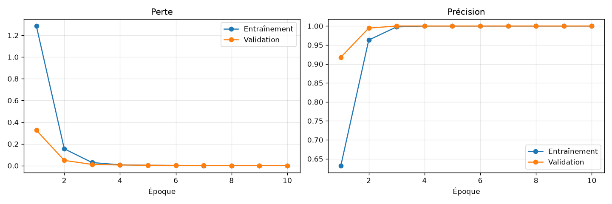

# CNN sur la langue des signes (ASL) : analyse

Jeu de données : Sign Language MNIST (24 lettres, images 28 x 28).
Modèle : 2 couches Conv2D + MaxPooling, Flatten, Dense(128), sortie softmax. 10 époques.

| | Entraînement | Validation | Test officiel |
|---|---|---|---|
| Précision | 100,00 % | 100,00 % | 91,33 % |
| Perte | 0,0005 | 0,0007 | - |

## La précision d'entraînement est-elle beaucoup plus élevée que celle de validation ?

Non. Après 10 époques, les deux atteignent 100 %, avec un écart nul.

## La perte de validation augmente-t-elle alors que la perte d'entraînement diminue ?

Non. Les deux pertes baissent ensemble jusqu'à la dernière époque, et la perte de validation atteint son minimum à l'époque 10, sans remonter.

## Conclusion

D'après les seules courbes, le modèle ne présente ni sous-apprentissage ni surapprentissage. Mais une validation à 100 % est trop belle pour être vraie : dans ce jeu de données, beaucoup d'images sont des variantes légèrement modifiées des mêmes photos, et la validation contient donc des images presque identiques à celles de l'entraînement. Sur le jeu de test officiel, composé d'autres photos, la précision tombe à 91,33 %. Le modèle présente donc un surapprentissage masqué par la validation : il a en partie mémorisé les photos au lieu d'apprendre la forme des mains. Pour l'améliorer, on pourrait ajouter du Dropout et de l'augmentation de données (rotations, zooms, décalages), et construire la validation à partir de photos différentes.

